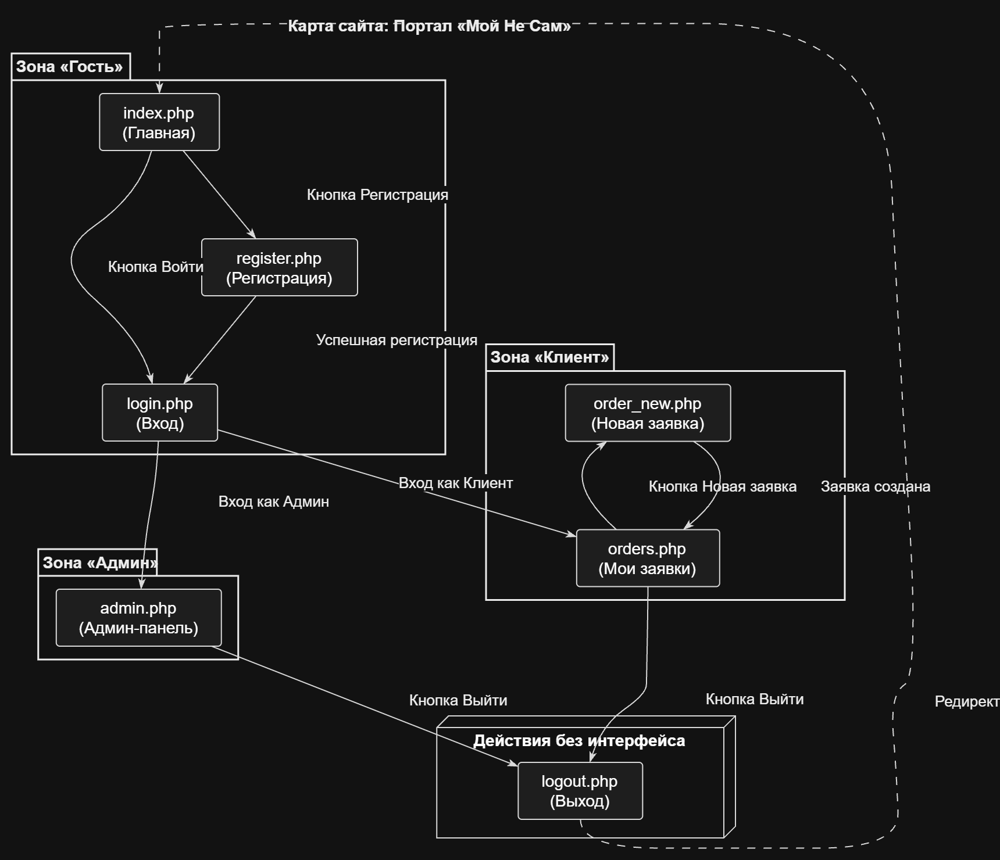
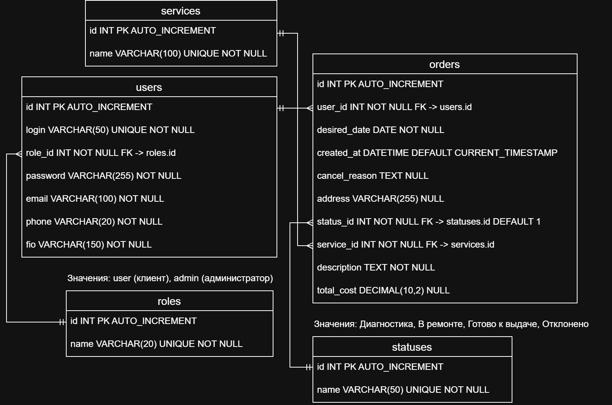

# Пакет проектной документации v0.1
**Проект:** Портал заявок «Мой Не Сам» (бытовые услуги)
**Авторы:** Смелый Владимир, Скорых Дмитрий (РВП-2.24)
**Дата:** 31.10.2026

## Состав пакета:
* [ТЗ-лист](tz.md) — техническое задание с проверяемыми требованиями.
* [Карта сайта](sitemap.png) — структура страниц и переходов (исходник: `sitemap.drawio`).
* [ER-диаграмма](er.png) — модель базы данных в 3НФ (исходник: `er.drawio`).
* [Сценарии использования](usecases.md) — ключевые сценарии работы пользователей.
* [Матрица трассировки](trace.md) — связь требований с реализацией.

